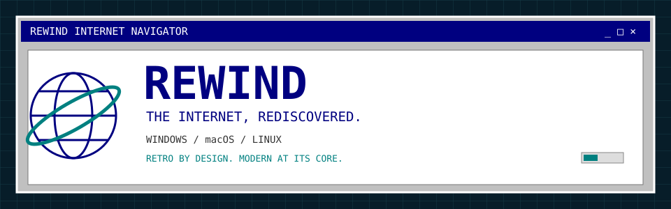
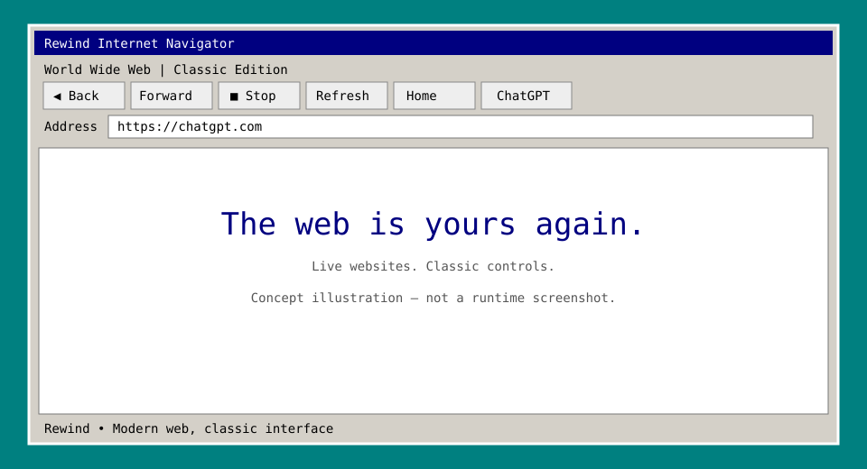

<p align="center"></p>

<p align="center"><b>Retro by design. Modern at its core.</b></p>
<p align="center"><a href="https://github.com/AndySync-09/Rewind-Browser/actions"></a>  </p>

## Welcome to the World Wide Web

Rewind is an experimental desktop browser inspired by the internet of the late 1990s and early 2000s. The project combines classic browser controls with a modern Chromium engine. Nostalgia belongs in the interface, not the security stack.

<p align="center"></p>

*Interface concept illustration, not a verified runtime screenshot.*

## Development status

The initial implementation lives on the [foundation branch](https://github.com/AndySync-09/Rewind-Browser/tree/foundation). Follow [pull request #1](https://github.com/AndySync-09/Rewind-Browser/pull/1) for integration progress.

| Platform | Target package | Status |
| --- | --- | --- |
| Windows | EXE | CI configured |
| macOS | DMG | CI configured |
| Linux | AppImage | CI configured |

Build artifacts, if successful, are available through [GitHub Actions](https://github.com/AndySync-09/Rewind-Browser/actions). Experimental artifacts are unsigned and not production releases.

## Run locally

Requires Node.js and npm.

```sh
git clone -b foundation https://github.com/AndySync-09/Rewind-Browser.git
cd Rewind-Browser
npm install
npm start
```

## Architecture

Electron hosts a sandboxed Chromium WebContentsView, separated from the local browser toolbar. The foundation includes navigation, a classic interface and a shortcut to the official ChatGPT website. Context isolation and web security are enabled; Node integration is disabled in web renderers. Permissions and popups are denied in this initial implementation.

## Roadmap

- [x] Classic browser shell and navigation source
- [x] Cross-platform packaging configuration
- [ ] Verify builds and runtime behavior on all target platforms
- [ ] Tabs, bookmarks, history and downloads
- [ ] Private sessions and granular permissions
- [ ] ChatGPT authentication, streaming and upload compatibility tests
- [ ] Optional retro page styling and historical web exploration
- [ ] Dependency locking, license review, security audit and signed releases

## Security and privacy

The project is not yet security audited. Do not rely on experimental builds for sensitive browsing. ChatGPT compatibility is a target, not a verified claim. Rewind is independent and is not affiliated with OpenAI or Chromium's maintainers. No legacy security protocols are required for the visual design.

See the [security notes](https://github.com/AndySync-09/Rewind-Browser/blob/foundation/SECURITY.md) and [development notes](https://github.com/AndySync-09/Rewind-Browser/blob/foundation/DEVELOPMENT.md).

## Contributing

Use GitHub issues for reproducible bugs and feature proposals. Include the operating system, architecture, build revision and reproduction steps. Never include credentials or session tokens. Licensing and third-party notices are pending; public source visibility alone does not grant an open-source license.

---

<p align="center"><b>Reconnect with the Internet.</b></p>
